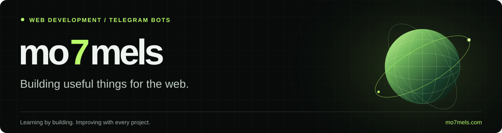

<p align="center">
  
</p>

<p align="center">
  <a href="https://www.mo7mels.com">
    
  </a>
  <a href="https://www.mo7mels.com/portfolio/">
    
  </a>
</p>

## Hi, I'm mo7mels.

I build web tools and Telegram bots for creators and online communities. I learn by turning ideas into working projects, improving their interfaces, and adding useful features along the way.

---

```text
mo7mels@127.0.0.1:~$ cat contact.txt
```

<p align="center">
  <a href="https://t.me/Nozvxa">
    
  </a>
  <br>
  <a href="https://github.com/MO7EMMD">
    
  </a>
</p>

---

### Featured projects

| Project | What it does | Explore |
| --- | --- | --- |
| **Mo7mels** | A creator workspace for generating, previewing, and saving embeds from YouTube, TikTok, Instagram, and web links. | [Website](https://www.mo7mels.com) · [Source](https://github.com/MO7EMMD/Mo7mels) |
| **APQRINO** | A Telegram bot for channel publishing, member moderation, join approvals, welcome messages, and group rules. | [Open bot](https://t.me/Apqrinobot) · [Project overview](https://www.mo7mels.com/portfolio/#apqrino-title) |

### Tools in my projects

**Interfaces:** HTML, CSS, JavaScript, React, Vite  
**Backends:** Node.js, Express, Telegram Bot API  
**Data and workflow:** PostgreSQL, Git, GitHub

### What I'm focused on

- Building clear, responsive interfaces.
- Making everyday tools easier to use.
- Learning through practical web and bot projects.

---

Explore more of my work at **[mo7mels.com/portfolio](https://www.mo7mels.com/portfolio/)**.
